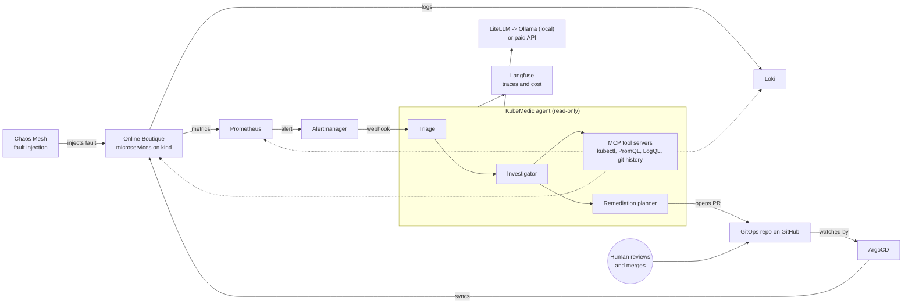

# KubeMedic

**A self-healing Kubernetes incident-response agent.** It detects a failure in a running microservice system, investigates it with read-only tools, and opens the fix as a pull request. A human approves, and GitOps (ArgoCD) deploys it. An evaluation pipeline measures how well the agent does, on local models and on a paid API.

> **Status: in development.** The platform layer is built and verified (see [Status](#status)). The agent, the fault benchmark and the results are planned and not done yet. Nothing in this README claims a result that has not been measured; unmeasured numbers are marked `TBD`.

## Headline results

| Metric | Local model(s) via Ollama | Paid-API baseline |
|---|---|---|
| Faults resolved | `TBD` / 12 | `TBD` / 12 |
| Median time-to-fix (agent time) | `TBD` s | `TBD` s |
| Cost per incident | `TBD` | `TBD` |

Results will be filled in from recorded benchmark runs committed to `evals/results/`. Until those exist, the table stays `TBD`.

## Why this project

When production breaks, an on-call engineer repeats the same loop: read the alert, check pod status, read logs and metrics, form a hypothesis, find the config that caused it, fix it. Most of the time goes to investigation, not to typing the fix.

KubeMedic automates the investigation and proposes the fix, but does **not** apply it. Its only write path is a pull request that a human reviews. That boundary is the central design decision.

## How it works



One incident, end to end:

1. A fault is injected, for example a memory limit that is too low for a service.
2. Prometheus and Loki capture the symptoms (restarts, `OOMKilled`, error logs) and Alertmanager fires a webhook.
3. The agent triages the alert, then the investigator calls read-only tools to find the root cause.
4. The planner edits the manifest in the GitOps repo and opens a pull request with the diff, its reasoning and its evidence.
5. A human reviews and merges. ArgoCD syncs the cluster and the service recovers.
6. The eval harness compares the outcome with the known root cause and the known correct fix, then scores the run.

## Stack

Running today: kind, Ollama, and the CLI tooling (`kubectl`, `helm`, `terraform`). Everything else below is planned.

| Layer | Tool | Why this one |
|---|---|---|
| Cluster | kind (Kubernetes 1.37.0, pinned by image digest) | Disposable, free, reproducible; runs entirely on one workstation |
| Target system | Google Online Boutique | A realistic microservice app (about 11 services over gRPC) with a built-in load generator |
| Packaging | Helm | Fixes become small, reviewable edits to a values file |
| Metrics, logs, alerts | Prometheus, Loki, Grafana, Alertmanager | Standard open-source observability stack; the agent's "eyes" |
| Telemetry | OpenTelemetry | Vendor-neutral instrumentation |
| Fault injection | Chaos Mesh, plus faulty commits to the GitOps repo | Reproducible failures with known root causes |
| GitOps | ArgoCD | Git is the source of truth, so a PR is the only change that sticks |
| Agent | LangGraph, tools exposed over MCP | Explicit stages (triage, investigate, plan) and a clean read-only tool boundary |
| Model layer | LiteLLM -> Ollama (local) or a paid API | Swapping models is a config change, which gives the comparison table almost for free |
| LLM tracing | Langfuse Cloud (free tier) | Every model call and tool call, with tokens, latency and cost |
| Policy | Kyverno | Guardrails on what a merged fix can create, as defence in depth |
| CI | GitHub Actions | Terraform validation, lint, replay-based eval gate |
| IaC | Terraform (validated in CI only) | Shows the skill without needing a cloud account |

## Design decisions

- **Pull request, not `kubectl`.** The agent cannot change the cluster. Every change is reviewable, auditable and revertible. With ArgoCD in place, a direct patch would also be reverted as drift, so a change to Git is the only fix that persists.
- **Safety lives in architecture, not in the prompt.** A read-only RBAC service account, PR-only writes, a token and cost budget per incident, and human approval. None of these rely on the model behaving well.
- **Tool output is untrusted input.** Logs are written by whatever is running in the cluster, so a log line can contain a prompt injection. Tools return truncated, structured output, and the agent has no write access to be tricked into using.
- **Model-agnostic by design.** All model calls go through LiteLLM. The same benchmark runs against local and paid models.
- **Few, simple tools.** Local models are weaker at multi-step tool calling, so the tool set is small, with tight schemas and truncated outputs.
- **Evals as a CI gate, at zero cost.** CI replays recorded agent trajectories, so pull requests are checked without any model calls. Live benchmark runs happen manually and rarely.
- **Reproducibility.** Tool versions are pinned and every download is checked against the publisher's SHA-256. Installers are idempotent. A one-command `make up` is planned.

## Evaluation (planned)

Each scenario has a known root cause and a known correct fix. Candidate faults, to be finalised with ground truth when the benchmark is built:

| Fault | Typical symptom | Expected fix |
|---|---|---|
| Memory limit too low | `OOMKilled`, `CrashLoopBackOff` | Raise the memory limit |
| Bad image tag | `ImagePullBackOff` | Correct the tag |
| Wrong value in a ConfigMap | Service errors, wrong upstream | Correct the value |
| Bad startup argument | Crash loop | Correct the argument |
| Service selector does not match pod labels | Healthy pods, empty endpoints | Correct the selector |
| Wrong `targetPort` on a Service | Connection refused | Correct the port |
| CPU limit too low | Throttling, high latency | Raise the CPU limit |
| Replicas set to 0 | Service unavailable | Restore replicas |
| Failing readiness probe path | Pods never ready | Correct the probe |
| Connection pool setting too low | Timeouts under load | Raise the pool size |
| Bad Secret reference | `CreateContainerConfigError` | Correct the reference |
| Resource request larger than any node | Pod stuck `Pending` | Lower the request |

Metrics, defined before any run:

- **Resolved:** the agent's PR, applied to a fresh copy of the faulted environment, restores health, and its stated root cause matches the ground truth.
- **Time-to-fix:** time from the alert firing to the PR being opened. Human review time is excluded, otherwise the metric measures how fast a person clicks.
- **Cost per incident:** tokens and, for paid models, dollars, from Langfuse.
- **Variance:** each scenario is run several times, and results are reported as counts (for example 8/12), not percentages, because the sample is small.

A lower success rate on local models than on a frontier model is a finding to report, not something to hide.

## Where the agent fails and why

`TBD`: filled in from real benchmark runs. This section is meant to stay honest.

## Limits, stated plainly

- It runs on a local single-control-plane kind cluster, which is not production-grade.
- The replay-based CI gate verifies parsing, tool wiring, scoring and guardrails. It does not prove the model is any good; only live runs measure that.
- Terraform is validated in CI, not applied to a cloud account.
- Benchmarks come from one workstation, with a small number of scenarios.

## Status

Done and verified:

- [x] WSL2 with systemd enabled and Docker Engine running (set up by hand, not yet scripted)
- [x] Pinned, SHA-256-verified installers for `kubectl`, `kind`, `helm`, `terraform`, `jq`
- [x] Three-node kind cluster (1 control plane, 2 workers) with Kubernetes pinned by digest
- [x] Ollama 0.40.13 as a systemd service, with both NVIDIA Quadro GV100 (Volta) GPUs verified and a tool-calling smoke test passed
- [x] `make doctor` environment check

Planned:

- [ ] Online Boutique and the monitoring stack (Prometheus, Loki, Grafana, Alertmanager)
- [ ] ArgoCD and the GitOps repo layout
- [ ] First fault scenarios and the read-only investigation tools
- [ ] Diagnosing agent with Langfuse tracing
- [ ] PR-based remediation with a human approval gate
- [ ] 10 to 12 fault scenarios, benchmark harness and scoring
- [ ] Replay-based eval gate and Terraform validation in CI
- [ ] Local-model benchmark, optional paid-API baseline, comparison table
- [ ] Demo video and Grafana dashboard for time-to-fix and cost

## Quick start (what works today)

Prerequisites: Ubuntu 22.04 on WSL2 with systemd enabled, Docker Engine running, `curl`, `python3` and [`uv`](https://docs.astral.sh/uv/).

```bash
git clone https://github.com/kovarthanmuthusamy/Kubmedic.git && cd Kubmedic
./infra/bootstrap/install-tools.sh     # kubectl, kind, helm, terraform, jq (pinned, checksum-verified)
./infra/bootstrap/install-ollama.sh    # Ollama as a systemd service (asks for sudo once)
kind create cluster --config infra/kind/cluster.yaml
make doctor                            # checks tools, Docker, GPUs and Ollama
```

A one-command `make up` / `make down` is planned.

## Repository layout

```
infra/bootstrap/   installers for the tools and the Ollama service
infra/kind/        kind cluster definition
infra/terraform/   IaC, validated in CI only
gitops/            what ArgoCD watches (app, monitoring, chaos, policy)
agent/             LangGraph agent and its read-only tools
chaos/             fault scenarios: manifest, root cause, expected fix
evals/             benchmark harness, scoring, recorded trajectories, results
docs/              architecture notes and learning labs
scripts/           helper scripts (doctor, model pulls)
```

## Hardware tested

Ubuntu 22.04 on WSL2, 2x NVIDIA Quadro GV100 (32 GB each, Volta). Volta has no native bf16, so quantised GGUF models are used.

## Author

[kovarthanmuthusamy](https://github.com/kovarthanmuthusamy)
